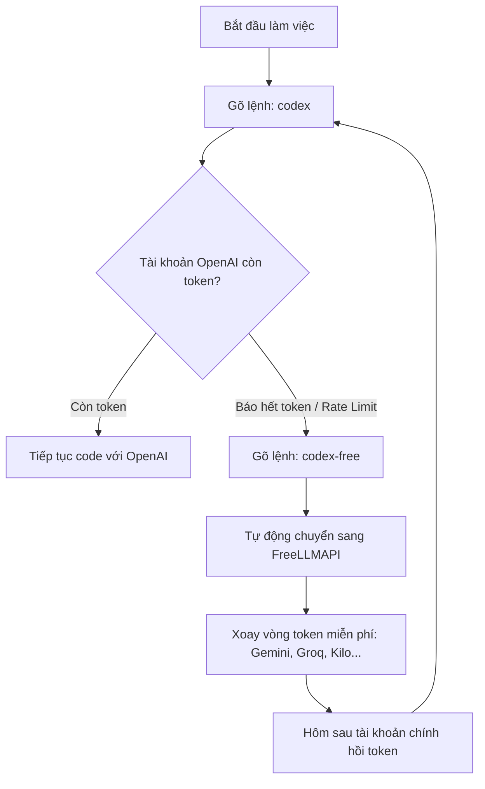

# Hướng Dẫn Sử Dụng FreeLLMAPI Cho Codex CLI

Tài liệu này tổng hợp toàn bộ hướng dẫn từ A–Z về cách vận hành **FreeLLMAPI** và thiết lập cơ chế **dự phòng (Fallback) khi Codex hết token**.

---

## 1. Giới thiệu tổng quan

* **FreeLLMAPI** là AI Gateway / Reverse Proxy cục bộ giúp tổng hợp hạn mức miễn phí (Free Tier) từ hơn 87 nhà cung cấp LLM (Google AI Studio, Groq, Mistral, OpenRouter, v.v.) và các cổng miễn phí không cần key (Keyless) thành **1 endpoint chuẩn duy nhất**.
* **Mục tiêu**: Làm nguồn token dự phòng 100% miễn phí cho Codex CLI khi tài khoản OpenAI (ChatGPT Plus/Team/Free) của bạn chạm trần hạn mức (Rate Limit / Quota Exceeded).

---

## 2. Khởi chạy FreeLLMAPI Server

Mở Terminal và thực hiện các bước sau:

```bash
cd /Users/nguyenhuuhung/Documents/side-projects/freellmapi

# 1. Cài đặt dependencies (chỉ cần chạy lần đầu)
npm install

# 2. Tạo khóa mã hóa bảo mật và file .env (nếu chưa có)
ENCRYPTION_KEY="$(node -e 'console.log(require("crypto").randomBytes(32).toString("hex"))')"
printf "ENCRYPTION_KEY=%s\nPORT=3001\n" "$ENCRYPTION_KEY" > .env

# 3. Khởi chạy server
npm run dev
```

* **Dashboard Web**: [http://localhost:3001](http://localhost:3001)
* **API Endpoint**: `http://localhost:3001/v1`

---

## 3. Cấu hình Provider & API Keys

### Lựa chọn A: Dùng ngay KHÔNG CẦN NẠP KEY (Chế độ Keyless)
FreeLLMAPI tích hợp sẵn các nhà cung cấp công cộng không cần đăng ký tài khoản:
* **Kilo Gateway**, **OVH AI Endpoints**, **AI Horde**, **Pollinations**.
* **Cách kích hoạt**: 
  1. Vào [http://localhost:3001](http://localhost:3001)
  2. Tại trang **Keys**, nếu thấy thông báo *"No-key providers available (N) · Enable all"*, bấm **Enable all**.
  3. Hoặc bấm `+ Add key` ➔ chọn provider (ví dụ `Kilo Gateway`, `AI Horde`) ➔ để trống ô API key và bấm Lưu.

### Lựa chọn B: Nạp Key Free Tier chất lượng cao (Khuyên dùng cho Coding)
Đăng ký tài khoản miễn phí để nhận token hạn mức cao và tốc độ nhanh:
1. **Google AI Studio** (Gemini 2.0 Flash, 1.5 Flash): [aistudio.google.com/apikey](https://aistudio.google.com/apikey)
2. **Groq** (Llama 3.3 70B, tốc độ ~300 token/s): [console.groq.com/keys](https://console.groq.com/keys)
3. **Mistral AI**: [console.mistral.ai/api-keys/](https://console.mistral.ai/api-keys/)
4. **OpenRouter**: [openrouter.ai/keys](https://openrouter.ai/keys)

> **Mở nhanh form thêm key theo đường dẫn:**
> * Thêm Google: [http://localhost:3001/keys?add=google](http://localhost:3001/keys?add=google)
> * Thêm Groq: [http://localhost:3001/keys?add=groq](http://localhost:3001/keys?add=groq)
> * Thêm Mistral: [http://localhost:3001/keys?add=mistral](http://localhost:3001/keys?add=mistral)
> * Thêm OpenRouter: [http://localhost:3001/keys?add=openrouter](http://localhost:3001/keys?add=openrouter)

### Nạp nhiều key cùng lúc (Không cần nhập thủ công từng cái):
* **Cách 1 (Paste Several)**: Mở popup `+ Add key`, bấm vào dòng chữ *"Paste several keys at once"* để dán danh sách nhiều key (mỗi dòng 1 key).
* **Cách 2 (Declarative File)**: Tạo file `freellmapi.config.json` chứa danh sách key và khai báo biến `FREEAPI_CONFIG_PATH` trong `.env`. Server sẽ tự nạp mỗi khi khởi động.

---

## 4. Lấy Unified API Key

Tại thanh trên cùng của giao diện [http://localhost:3001](http://localhost:3001), bấm copy mã **Unified API Key** (có dạng `freellmapi-...`).

---

## 5. Thiết lập Codex CLI để chỉ chạy dự phòng khi hết token

Chúng ta sử dụng tính năng **Profile** của Codex. Thiết lập này giữ nguyên lệnh `codex` mặc định và tạo thêm lệnh `codex-free`.

### Bước 1: Cấu hình Profile cho Codex
Codex CLI hiện đại yêu cầu mỗi profile là một file riêng (`<name>.config.toml`):

1. File chính [config.toml](/Users/nguyenhuuhung/.codex/config.toml) khai báo provider:
```toml
# --- Cấu hình FreeLLMAPI Provider ---
[model_providers.freellmapi]
name = "FreeLLMAPI"
base_url = "http://localhost:3001/v1"
wire_api = "responses"
env_key = "FREELLMAPI_API_KEY"
requires_openai_auth = false
model_catalog_url = "http://localhost:3001/v1/codex/models"
```

2. Tạo file profile [free.config.toml](/Users/nguyenhuuhung/.codex/free.config.toml):
```toml
model = "auto"
model_provider = "freellmapi"
model_context_window = 128000
model_auto_compact_token_limit = 115200

[model_providers.freellmapi]
name = "FreeLLMAPI"
base_url = "http://localhost:3001/v1"
wire_api = "responses"
env_key = "FREELLMAPI_API_KEY"
requires_openai_auth = false
model_catalog_url = "http://localhost:3001/v1/codex/models"
```

### Bước 2: Thêm biến môi trường và Alias vào Shell
Mở terminal và chạy lệnh sau (thay `freellmapi-...` bằng Unified Key của bạn):

```bash
cat << 'EOF' >> ~/.zshrc

# FreeLLMAPI configuration for Codex
export FREELLMAPI_API_KEY="freellmapi-..."
alias codex-free="codex --profile free"
EOF

source ~/.zshrc
```

---

## 6. Quy trình sử dụng hàng ngày



* **Bình thường**: Gõ `codex` để sử dụng tài khoản ChatGPT / OpenAI chính chủ.
* **Khi hết token / chạm trần Rate limit**:
  ```bash
  codex-free
  ```
  Codex sẽ chuyển sang profile `free`, tự động định tuyến qua FreeLLMAPI mà không làm gián đoạn công việc của bạn.
